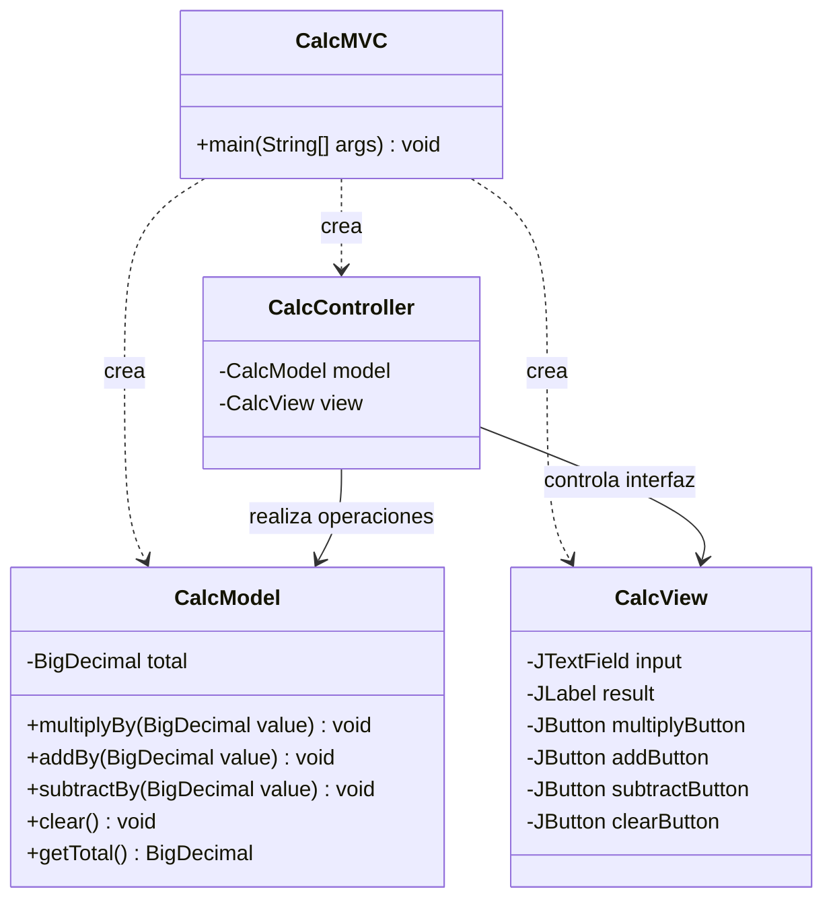

# Calculadora MVC

Calculadora sencilla en Java Swing con **sumar, restar, multiplicar y limpiar**. Usa `BigDecimal` para trabajar con decimales.

El total comienza en **1** y cada operacion usa el total acumulado. **Limpiar** lo regresa a 1.

# **[Ver video explicativo](https://youtu.be/p8Z2PbJRp-Y)**

## Ejecutar

```bash
javac CalcMVC.java CalcModel.java CalcView.java CalcController.java
java CalcMVC
```

O ejecutar el archivo `CalculadoraMVC.jar` con `java -jar CalculadoraMVC.jar`.

**MVC:** `CalcModel` calcula, `CalcView` muestra los botones y `CalcController` conecta ambos.


## Diagrama de clases


